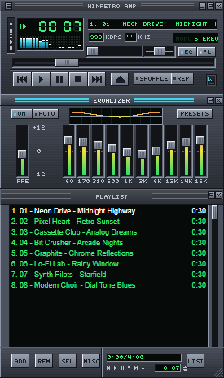
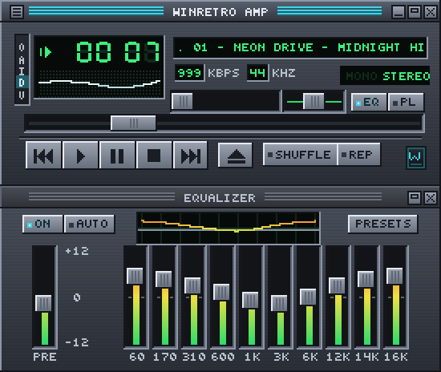
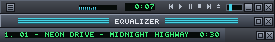

# WinRetro Amp

[Español](#winretro-amp) | [English](#english)

Un homenaje a los reproductores de MP3 clásicos con skins de finales de los 90 (estilo 2.x), hecho con .NET 10, WPF y NAudio. Tiene la misma disposición y el mismo comportamiento: reproductor principal de 275×116, ecualizador de 10 bandas y lista de reproducción, ventanas que se acoplan entre sí, modo sombra, doble tamaño y compatibilidad con skins clásicos `.wsz`.

<p align="center">
  
</p>

> **Sobre la marca:** el nombre, el icono, el emblema y el skin por defecto ("Graphite") son **originales** y se dibujan en código (`DefaultSkinPainter`). No se incluye ningún bitmap, logotipo, nombre ni sonido de otro reproductor. Lo que sí se respeta es el **formato** de los skins clásicos (nombres de archivo y coordenadas de los sprites), para que cada persona pueda cargar los skins que ya tenga.

## Funciones

**Reproducción**
- MP3, AAC/M4A, WMA, FLAC, OGG Vorbis, WAV y AIFF (Media Foundation, NVorbis).
- Radios de Internet HTTP/Shoutcast en MP3, con el título de la canción leído de los metadatos ICY.
- Reproducir, pausar, detener, anterior y siguiente, avanzar y retroceder, aleatorio (todas las pistas suenan una vez antes de repetir) y repetir.
- Volumen y balance, elección del dispositivo de salida y teclas multimedia del teclado en todo el sistema.

**Ventana principal**
- Tiempo transcurrido o restante (clic sobre los dígitos) y parpadeo en pausa.
- Analizador de espectro (barras gruesas o finas, con picos y caída configurable), osciloscopio o apagado (clic sobre el visualizador).
- Título que se desplaza (se puede arrastrar), kbps, kHz y mono/estéreo.
- Barra lateral O A I D V: opciones, siempre visible, información del archivo, doble tamaño y visualización.
- Modo sombra (275×14) con minitiempo, minivisualizador, minibarra de posición y controles.

**Ecualizador**
- 10 bandas (60 Hz a 16 kHz, ±12 dB) más preamplificador, ON/AUTO y curva de respuesta.
- Presets incluidos y propios: guardar, borrar y cargar. Importa y exporta `.eqf` y bibliotecas `.q1`.
- AUTO: guarda y aplica un preset para cada archivo.
- Doble clic en un control lo devuelve a 0 dB; la rueda del ratón lo ajusta.

**Lista de reproducción**
- Redimensionable en pasos de 25×29 px, con colores y fuente del skin (`pledit.txt`).
- Selección con clic, Ctrl, Mayús y Ctrl+A; arrastrar para reordenar; soltar archivos y carpetas desde el Explorador.
- Menús emergentes ADD, REM, SEL, MISC y LIST, como el original: añadir archivos, carpeta o URL; quitar duplicados o archivos que ya no existen; recortar; ordenar; invertir; aleatorizar; exportar a HTML.
- Abre y guarda M3U, M3U8 y PLS. Muestra el tiempo total y el de la selección, y tiene minicontroles y modo sombra.
- **Saltar a archivo** (J): búsqueda por palabras.
- **Información del archivo** (Alt+3): datos técnicos y edición de etiquetas (título, artista, álbum, año, pista, género, comentario).

**Ventanas y sistema**
- Imanes a 10 px entre ventanas y bordes de la pantalla; al mover la principal se mueven las acopladas.
- Doble tamaño (Ctrl+D) y píxeles siempre nítidos con cualquier escala de Windows.
- Siempre visible, icono en la bandeja del sistema y opción de minimizar a la bandeja.
- Una sola instancia: al abrir canciones desde el Explorador se envían a la ventana que ya está abierta (`/ADD` para encolar).
- Asociación de archivos por usuario (sin permisos de administrador) desde Preferencias.
- Recuerda posiciones, skin, EQ, volumen, modos y la última lista (`%APPDATA%\WinRetroAmp`). Opcionalmente reanuda donde lo dejaste.

## Capturas

| Reproductor, ecualizador y lista acoplados | Doble tamaño (Ctrl+D) con osciloscopio |
|:---:|:---:|
|  |  |

<p align="center">
  <br>
  <em>Modo sombra (Ctrl+W) en las tres ventanas</em>
</p>

*Todas las capturas usan el skin por defecto, Graphite, con pistas de demostración generadas.*

## Skins

Incluye siete skins seleccionables directamente en **Skins**: Graphite, Amber (ámbar), Arctic (hielo), Rose (rosa), Copper (cobre), Emerald (esmeralda) y Violet (violeta). Cada variante combina reproductor, ecualizador, lista y visualizador, y se recuerda al reiniciar. Sus archivos `.wsz` están en `skins/`; `tools/GenerateAssets` regenera toda la colección.

Menú principal (clic derecho) → **Skins** → *Load skin...*. Se copia a `%APPDATA%\WinRetroAmp\Skins` y queda en la lista. Se leen `main`, `cbuttons`, `titlebar`, `shufrep`, `posbar`, `volume`, `balance`, `monoster`, `playpaus`, `numbers`/`nums_ex`, `text`, `eqmain`, `eq_ex` y `pledit` (BMP o PNG), además de `viscolor.txt` y `pledit.txt`. Los nombres no distinguen mayúsculas y pueden estar en una subcarpeta del zip; lo que falte se toma del skin por defecto.

*Export default skin as .wsz...* guarda el skin Graphite como plantilla para crear el tuyo (también está en `skins/WinRetroAmp-Graphite.wsz`).

## Atajos de teclado

| Tecla | Acción | Tecla | Acción |
|---|---|---|---|
| Z X C V B | Anterior, reproducir, pausa, detener, siguiente | ← / → | −5 s / +5 s (con Ctrl, ±1 min) |
| ↑ / ↓ | Volumen | Num 1 / Num 3 | −10 / +10 pistas |
| L, Mayús+L, Ctrl+L | Abrir archivo, carpeta o URL | J | Saltar a archivo |
| S / R | Aleatorio / repetir | Alt+3 | Información del archivo |
| Alt+E / Alt+G | Lista / ecualizador | Ctrl+D | Doble tamaño |
| Ctrl+A | Siempre visible (en la lista: seleccionar todo) | Ctrl+T | Tiempo transcurrido o restante |
| Ctrl+W | Modo sombra (Ctrl+Mayús+W lista, Ctrl+Alt+W EQ) | Ctrl+P | Preferencias |
| Supr, Intro, Alt+↑/↓ | Lista: quitar, reproducir, mover | Alt+S | Cargar skin |

## Arquitectura

```
src/WinRetroAmp.Core   Sin interfaz: motor de audio (NAudio 3), EQ biquad, FFT, radio ICY, lista,
                       M3U/PLS, EQF, etiquetas (TagLibSharp), skins (.wsz), ajustes
src/WinRetroAmp        WPF: ventanas dibujadas con sprites (PixelImage → WriteableBitmap, escala entera
                       con NearestNeighbor), acoplamiento, menús, diálogos, bandeja, teclas multimedia
tests/                 xUnit: 22 pruebas (EQ ±12 dB, FFT, lista, aleatorio, formatos, skins, etiquetas)
tools/GenerateAssets   Genera app.ico y el .wsz del skin por defecto a partir del código
```

Cadena de audio: `lector → estéreo → ecualizador → analizador → volumen/balance → WaveOut`.

## Compilar y ejecutar

Requisitos: Windows 10/11 y el SDK de .NET 10.

```powershell
dotnet run --project src/WinRetroAmp            # ejecutar
dotnet test                                     # pruebas
dotnet run --project tools/GenerateAssets -- .  # regenerar icono y skin por defecto

# Un único .exe autocontenido (no necesita .NET instalado):
dotnet publish src/WinRetroAmp -c Release -r win-x64 --self-contained -p:PublishSingleFile=true -p:IncludeNativeLibrariesForSelfExtract=true -p:EnableCompressionInSingleFile=true -o artifacts/publish
```

Para un modo portátil o para hacer pruebas sin tocar tu perfil, define `WINRETROAMP_DATA` con la carpeta donde quieres guardar ajustes, lista y skins.

## Fuera de alcance (v1)

Plugins nativos (`in_`, `out_`, `dsp_`, `vis_`, `gen_`), MilkDrop/AVS, biblioteca multimedia, skins modernos `.wal`, CD de audio, fundido entre canciones, formas de ventana `region.txt`, cursores de skin y radios en AAC (solo MP3).

---

## English

A tribute to classic skinnable MP3 players from the late 1990s (2.x style), built with .NET 10, WPF, and NAudio. It recreates their layout and behavior: a 275×116 main player, a 10-band equalizer and playlist, docking windows, shade mode, double size, and support for classic `.wsz` skins.

> **About the branding:** the name, icon, emblem, and default skin ("Graphite") are **original** and drawn in code (`DefaultSkinPainter`). No bitmaps, logos, names, or sounds from other players are included. The classic skin **format** (file names and sprite coordinates) is supported so users can load skins they already own.

### Features

**Playback**

- MP3, AAC/M4A, WMA, FLAC, OGG Vorbis, WAV, and AIFF (Media Foundation, NVorbis).
- HTTP/Shoutcast MP3 Internet radio, with song titles read from ICY metadata.
- Play, pause, stop, previous and next, seeking, shuffle (every track plays once before repeating), and repeat.
- Volume and balance, output device selection, and system-wide keyboard media keys.

**Main window**

- Elapsed or remaining time (click the digits), with blinking while paused.
- Spectrum analyzer (thick or thin bars, with peaks and configurable decay), oscilloscope, or no visualization (click the visualizer).
- Draggable scrolling title, kbps, kHz, and mono/stereo indicators.
- O A I D V sidebar: options, always on top, file information, double size, and visualization.
- Shade mode (275×14) with a mini time display, visualizer, seek bar, and controls.

**Equalizer**

- 10 bands (60 Hz to 16 kHz, ±12 dB), plus preamp, ON/AUTO, and a response curve.
- Built-in and custom presets: save, delete, and load. Import and export `.eqf` files and `.q1` libraries.
- AUTO: save and apply a preset for each file.
- Double-click a slider to reset it to 0 dB; use the mouse wheel to adjust it.

**Playlist**

- Resizable in 25×29 px steps, using the skin's colors and font (`pledit.txt`).
- Select with click, Ctrl, Shift, and Ctrl+A; drag to reorder; drop files and folders from File Explorer.
- Classic ADD, REM, SEL, MISC, and LIST pop-up menus: add files, folders, or URLs; remove duplicates or missing files; crop the playlist; sort; reverse; shuffle; export to HTML.
- Open and save M3U, M3U8, and PLS. Display total and selected playback time, with mini controls and shade mode.
- **Jump to file** (J): keyword search.
- **File information** (Alt+3): technical details and tag editing (title, artist, album, year, track, genre, comment).

**Windows and system integration**

- Windows snap within 10 px of each other and screen edges; moving the main window also moves docked windows.
- Double size (Ctrl+D) and crisp pixels at any Windows display scale.
- Always on top, system tray icon, and optional minimize to tray.
- Single instance: opening songs from File Explorer sends them to the existing window (`/ADD` to enqueue).
- Per-user file associations (no administrator privileges required), available in Preferences.
- Remembers window positions, skin, EQ, volume, modes, and the last playlist (`%APPDATA%\WinRetroAmp`). Optionally resumes where you left off.

### Screenshots

| Docked player, equalizer, and playlist | Double size (Ctrl+D) with oscilloscope |
|:---:|:---:|
|  |  |

<p align="center">
  <br>
  <em>Shade mode (Ctrl+W) in all three windows</em>
</p>

*All screenshots use the default Graphite skin with generated demo tracks.*

### Skins

Seven skins are available directly from **Skins**: Graphite, Amber, Arctic, Rose, Copper, Emerald, and Violet. Each variant styles the player, equalizer, playlist, and visualizer, and persists across restarts. Their `.wsz` files are in `skins/`; `tools/GenerateAssets` regenerates the entire collection.

Main menu (right-click) → **Skins** → *Load skin...*. The skin is copied to `%APPDATA%\WinRetroAmp\Skins` and added to the list. Supported assets include `main`, `cbuttons`, `titlebar`, `shufrep`, `posbar`, `volume`, `balance`, `monoster`, `playpaus`, `numbers`/`nums_ex`, `text`, `eqmain`, `eq_ex`, and `pledit` (BMP or PNG), plus `viscolor.txt` and `pledit.txt`. File names are case-insensitive and may be inside a ZIP subfolder; missing assets fall back to the default skin.

*Export default skin as .wsz...* saves the Graphite skin as a template for your own skin (also available at `skins/WinRetroAmp-Graphite.wsz`).

### Keyboard shortcuts

| Key | Action | Key | Action |
|---|---|---|---|
| Z X C V B | Previous, play, pause, stop, next | ← / → | −5 s / +5 s (with Ctrl, ±1 min) |
| ↑ / ↓ | Volume | Num 1 / Num 3 | −10 / +10 tracks |
| L, Shift+L, Ctrl+L | Open file, folder, or URL | J | Jump to file |
| S / R | Shuffle / repeat | Alt+3 | File information |
| Alt+E / Alt+G | Playlist / equalizer | Ctrl+D | Double size |
| Ctrl+A | Always on top (in the playlist: select all) | Ctrl+T | Elapsed or remaining time |
| Ctrl+W | Shade mode (Ctrl+Shift+W for playlist, Ctrl+Alt+W for EQ) | Ctrl+P | Preferences |
| Delete, Enter, Alt+↑/↓ | Playlist: remove, play, move | Alt+S | Load skin |

### Architecture

```text
src/WinRetroAmp.Core   No UI: audio engine (NAudio 3), biquad EQ, FFT, ICY radio, playlist,
                       M3U/PLS, EQF, tags (TagLibSharp), skins (.wsz), settings
src/WinRetroAmp        WPF: sprite-rendered windows (PixelImage → WriteableBitmap, integer scaling
                       with NearestNeighbor), docking, menus, dialogs, tray, media keys
tests/                 xUnit: 22 tests (EQ ±12 dB, FFT, playlist, shuffle, formats, skins, tags)
tools/GenerateAssets   Generates app.ico and the default skin .wsz from code
```

Audio pipeline: `reader → stereo → equalizer → analyzer → volume/balance → WaveOut`.

### Build and run

Requirements: Windows 10/11 and the .NET 10 SDK.

```powershell
dotnet run --project src/WinRetroAmp            # run
dotnet test                                     # tests
dotnet run --project tools/GenerateAssets -- .  # regenerate icon and default skin

# A single self-contained .exe (no .NET installation required):
dotnet publish src/WinRetroAmp -c Release -r win-x64 --self-contained -p:PublishSingleFile=true -p:IncludeNativeLibrariesForSelfExtract=true -p:EnableCompressionInSingleFile=true -o artifacts/publish
```

For portable use or testing without affecting your profile, set `WINRETROAMP_DATA` to the folder where you want to store settings, playlists, and skins.

### Out of scope (v1)

Native plugins (`in_`, `out_`, `dsp_`, `vis_`, `gen_`), MilkDrop/AVS, media library, modern `.wal` skins, audio CDs, crossfading, `region.txt` window shapes, skin cursors, and AAC radio streams (MP3 only).
